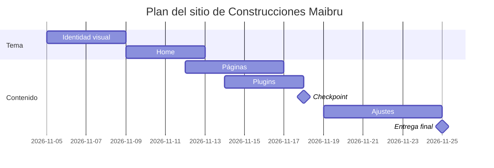

# Decisiones de mi sitio

**Emprendimiento:** Construcciones Maibru SpA
**Fecha:** 4 de noviembre de 2026 · **Última corrección:** 4 de noviembre de 2026

## 1. Plugins (10 pts)

Al menos **5 plugins**, cada uno vale 2 pts. **SEO** y **contacto** son obligatorios; los otros 3 los eliges según lo que necesita tu sitio (parte de `docs/03-funcionalidades.md`). Guía: `guia-investigar-plugins.md`.

| # | Funcionalidad | Plugin | Gratis o de pago | Qué incluye la versión gratis | Probado hasta (WP) | Requiere PHP | ¿Funciona con tema propio? | Enlace a la ficha |
|---|---|---|---|---|---|---|---|---|
| 1 | SEO (obligatorio) | Yoast SEO | Gratis, con versión Premium de pago | Análisis de contenido y legibilidad, título y meta descripción, mapa del sitio XML, datos estructurados básicos | 7.1.4 | 7.4 o superior | Sí, funciona con cualquier tema | https://wordpress.org/plugins/wordpress-seo/ |
| 2 | Contacto (obligatorio): llamar o escribir un correo rápido y consultar por una ventana específica | Forminator | (gratis o de pago, según la ficha) | (qué incluye la versión gratis, según la ficha) | (Tested up to) | (PHP version) | (según lo que veas en la ficha) | https://wordpress.org/plugins/forminator/ |
| 3 | Contactar por WhatsApp para pedir presupuesto, sin formularios | Joinchat | Gratis, con versión de pago (Premium) | Botón flotante de WhatsApp, mensaje inicial personalizable, horario de atención | 7.1.4 | 7.0 o superior | Sí, funciona con cualquier tema | https://wordpress.org/plugins/creame-whatsapp-me/ |
| 4 | Galería de trabajos realizados | Modula | Gratis, con versión Pro de pago | Galerías en cuadrícula y masonry, constructor drag-and-drop, soporte de video y lightbox | 7.1.4 | 5.6 o superior | Sí, la ficha dice que funciona con cualquier tema | https://wordpress.org/plugins/modula-best-grid-gallery/ |
| 5 | Experiencias de clientes: leerlas y dejar la propia (nombre, tipo de trabajo, opinión) | Strong Testimonials | Gratis, con versión de pago (Premium) | Formulario para recoger testimonios y formas de mostrarlos en el sitio | 7.1.4 | 5.6 o superior | Sí, hereda el estilo del tema que uses | https://wordpress.org/plugins/strong-testimonials/ |

**Alternativas anotadas (si uno falla):** Rank Math (SEO) · WPForms Lite (contacto) · Click to Chat (WhatsApp) · FooGallery (galería) · Site Reviews (experiencias).

## 2. Páginas de la fase 1 (5 pts)

**5 páginas**, 1 pt cada una. **Inicio** y **Contacto** son obligatorias; las otras 3 las eliges (no pueden ser del carro de compras).

| # | Página | Por qué la elijo (una línea) |
|---|---|---|
| 1 | Inicio (obligatoria) | Presenta la empresa y lleva rápido a pedir presupuesto. |
| 2 | Contacto (obligatoria) | Permite pedir presupuesto por WhatsApp, correo, teléfono o formulario. |
| 3 | Servicios | Responde al objetivo de conocer los servicios de construcción e instalación de ventanas. |
| 4 | Galería de trabajos | Permite ver trabajos realizados para comprobar la calidad del servicio. |
| 5 | Experiencias de clientes | Genera confianza antes de contratar con opiniones de otros clientes. |

**Páginas que dejo para después:** Catálogo de ventanas con búsqueda, filtros y variantes · Blog con categorías, comentarios y compartir · Comunas de la V Región donde trabaja la empresa · Redes sociales (Instagram y Facebook) · Filtro de la galería por tipo de obra o ventana (requiere Modula Pro, que es de pago).

## 3. Plan del tema (5 pts)

- **Nombre del tema:** Construcciones Maibru
- **Custom o descargado:** Custom, porque lo construyo yo mismo para que el diseño, los colores y las secciones se ajusten a lo que necesita Construcciones Maibru.
  
| Etapa | Desde | Hasta | Notas |
|---|---|---|---|
| Identidad visual | 5 nov | 8 nov | Logo, colores y tipografías de Construcciones Maibru |
| Home | 9 nov | 12 nov | Portada con llamado a pedir presupuesto |
| Páginas | 12 nov | 16 nov | Servicios, Galería, Experiencias y Contacto |
| Plugins | 14 nov | 17 nov | Instalar y configurar los 5 plugins |
| **Checkpoint (18 nov)** | 18 nov | 18 nov | Revisión y correcciones de este documento |
| Ajustes y formulario | 19 nov | 24 nov | Pruebas de formulario y WhatsApp, revisión en celular, SEO |
| **Entrega final (25 nov)** | 25 nov | 25 nov | Sitio terminado |

## 4. Plan B (5 pts)

Qué hago si algo no funciona. **Al menos 3 riesgos**, cada uno con su mitigación y cuándo se activa.

| Riesgo | Qué hago | Cuándo se activa (fecha o señal) |
|---|---|---|
| El tema propio no funciona o se rompe | Vuelvo al último commit; si no resulta, paso a un tema descargado | Miércoles 11 nov, o si el inicio no se ve bien |
| Un plugin (galería o experiencias) falla o no es compatible | Uso la alternativa anotada (FooGallery o Site Reviews) | Al instalarlo, o si la página tarda mucho en cargar |
| El correo del formulario de cotización no llega | Pruebo otra configuración de envío; mientras tanto dejo WhatsApp, teléfono y correo visibles | Antes del 18 nov, si la prueba no llega en 10 minutos |
| El botón de WhatsApp no abre el chat en el celular | Lo reemplazo por un enlace directo de WhatsApp en la página de Contacto | Al probar en el celular, antes del 25 nov |

## Cambios respecto de la Sumativa 2 (solo en el checkpoint del 18 nov)

| Qué cambié | Qué había antes | Por qué | Evidencia (captura o commit) |
|---|---|---|---|
| | | | |

**Decisión:** (continúo con mi propuesta / pivoteo, y por qué)
